<p align="center">
  
</p>

<p align="center">
  <a href="https://annitarik0.github.io/studyspot/"></a>
  
  
</p>

<h3 align="center">From routers to React Native to neural networks.</h3>

<p align="center">
I started with cables, routers and servers. Then I learned to build what runs on them: web apps, iPhone apps, cloud deployments.<br/>
I design what I build, in Figma first, then in code. Next stop: <b>artificial intelligence</b>.
</p>

<br/>

```js
const tarik = {
  basedIn:   ["Agadir, Morocco", "Chengdu, China"],
  builds:    ["iOS apps", "Flutter apps", "Laravel back ends", "3D websites"],
  ships_to:  "AWS ☁️",
  designsIn: ["Figma", "Photoshop", "After Effects"],
  speaks:    ["العربية", "Français", "English (B2)", "中文 (learning)"],
  next:      "Master's in Artificial Intelligence 🧠",
  dream:     "build something at Google one day",
};
```

## ✦ Things I've built

<table>
  <tr>
    <td width="50%"><a href="https://github.com/annitarik0/studyspot-app"></a></td>
    <td width="50%"><a href="https://github.com/annitarik0/beach-time"></a></td>
  </tr>
  <tr>
    <td width="50%"><a href="https://github.com/annitarik0/PFE--ANNISTOCK---STOCK-MANAGEMENT"></a></td>
    <td width="50%"></td>
  </tr>
</table>

<p align="center">
  🌐 <b>See StudySpot live:</b> <a href="https://annitarik0.github.io/studyspot/">annitarik0.github.io/studyspot</a>, a 3D landing page where the city is an equaliser that goes quiet wherever you point.
</p>

## ✦ The road so far

<p align="center">
  
</p>

<details>
<summary><b>Read it as text</b></summary>
<br/>

| Year | What | Where |
|---|---|---|
| 2021–23 | Technician diploma, Networks & Computer Systems (17.15/20) | ILEIC, Aït Melloul |
| 2023 | Network technician intern | INISEA Maroc |
| 2023 | Digital marketing intern | ESTELAR, Agadir |
| 2024 | Graphic designer & video editor | Rank Up agency |
| 2024–25 | Bachelor's, Web & Mobile Applications Development (16.75/20, "Très bien") | FST Béni Mellal |
| 2025–26 | Chinese language program | Chengdu Normal University |
| 2026 | AWS cloud + Mobile & Web App Design | Orange Digital Center |
| Next | Master's in Artificial Intelligence | loading ▋ |

</details>

## ✦ Toolbox

<p align="center">
  <br/>
  
</p>

<p align="center"><sub>Also: network design, router configuration, server administration · UML · SEO and digital marketing</sub></p>

## ✦ Say hi

<p align="center">
  <a href="mailto:annitarik9@gmail.com"></a>
</p>
<p align="center">Happy to talk about projects, AI programs or collaborations.</p>

<p align="center">
  
</p>
